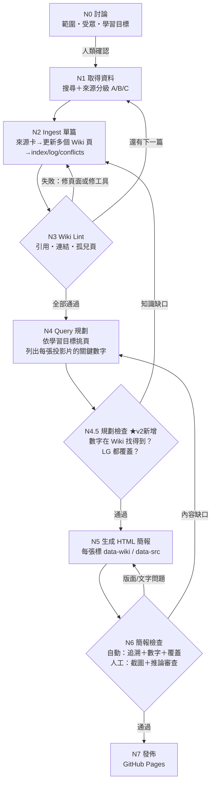

# Loop / Graph 設計

## 最終版（v2）流程圖

## 各節點做什麼

| 節點 | 輸入 → 輸出 | 誰做 | 檢查方式 |
|---|---|---|---|
| N0 討論 | 使用者想法 → `discussion/00-scope.md` | 人＋LLM | 人類確認 |
| N1 取得資料 | 關鍵字 → 候選來源，分 A/B/C 級 | LLM（web search） | 來源分級規則，C 級不收 |
| N2 Ingest | 1 篇來源 → 來源卡＋更新 3–6 個 Wiki 頁 | LLM | 交給 N3 |
| N3 Wiki Lint | Wiki → 錯誤清單 | `tools/lint_wiki.py` | R1–R6 規則 |
| N4 Query 規劃 | Wiki＋LG → `slide-plan.md` | LLM | 交給 N4.5 |
| N4.5 規劃檢查 | 計畫 → 錯誤清單 | `tools/check_plan.py` | P1–P3 規則 |
| N5 生成 | 計畫＋Wiki 頁 → `docs/index.html` | LLM | 交給 N6 |
| N6 簡報檢查 | HTML → 錯誤清單＋截圖 | `tools/check_slides.py`＋人工 | C1–C4 規則＋人工審查 |
| N7 發佈 | → GitHub Pages | 人 | 實際開網頁確認 |

## 哪些步驟會重複執行？
1. **Ingest 迴圈（N1→N2→N3）**：每篇資料跑一次，共 6 次。每次 ingest 都要通過 lint 才算完成，避免錯誤累積到最後才爆發。
2. **Lint 修正迴圈（N3→N2）**：lint 失敗就回去修，直到 0 錯誤。
3. **生成修正迴圈（N6→N5）**：版面或措辭問題，只重新生成有問題的投影片。

## 哪些地方需要檢查或重新生成？
- **N3**：數字沒引用、斷連結、孤兒頁 → 重寫該 Wiki 頁。
- **N4.5（v2）**：計畫要用的數字不在 Wiki → **回到 N2 補 ingest，或從計畫刪掉**，不能讓生成節點自己補。
- **N6**：投影片內容追溯不到 Wiki → 重新生成該張；若是知識缺口 → 回到 N4 甚至 N2。

## 為什麼這樣設計？
- **Wiki 是唯一的知識來源**：簡報不直接讀網路，只讀 Wiki。這樣每句話都能追溯到 `raw/` 的來源卡，錯誤也有固定地方可修。
- **檢查用程式而不是只靠 LLM 自己看**：LLM 檢查自己寫的東西，容易「看什麼都對」。可以規則化的部分（引用、數字、連結）交給確定性的腳本。
- **不能規則化的部分留給人**：例如「這句推論 Wiki 有沒有說」，目前仍需人工審查。
- **回饋邊指向「最早能修的節點」**：知識缺口不在簡報上補，而是回到 Ingest。這樣 Wiki 會越來越完整，下次產生簡報就不會再缺。

## v1 → v2 的差異
v1 沒有 N4.5，數字是否有依據要到 N6（生成之後）才檢查。實際執行發現生成節點會憑模型記憶補數字（3:30），所以 v2 把數字檢查前移到生成之前。詳見 [reflection.md](reflection.md)。
